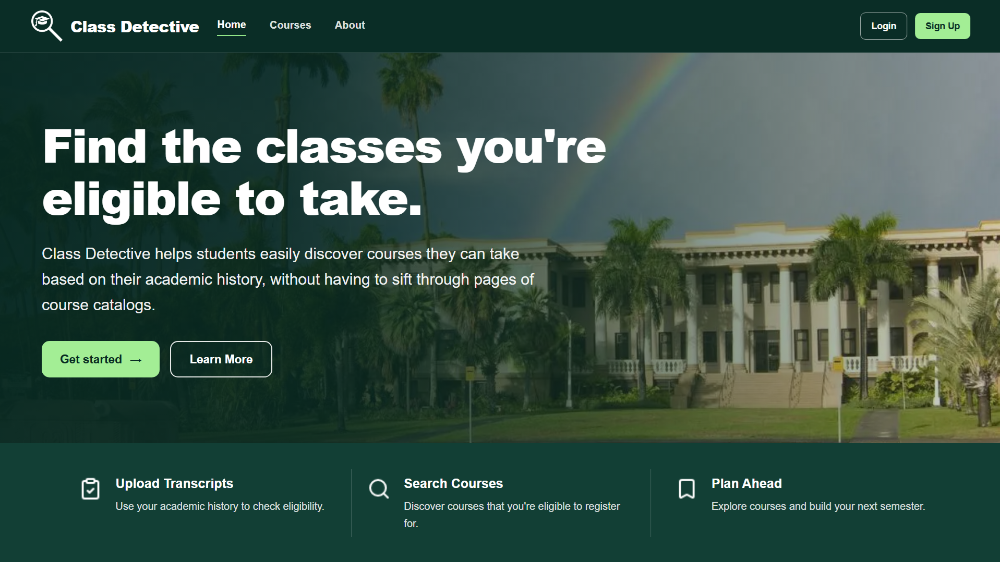
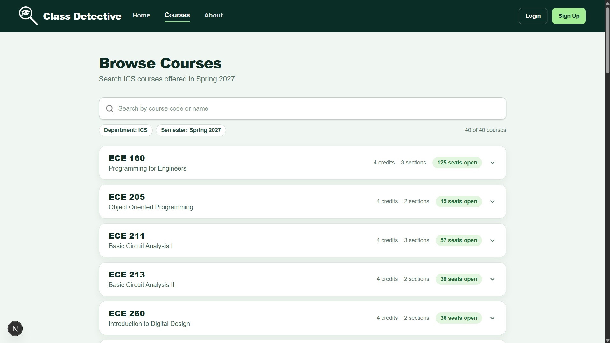
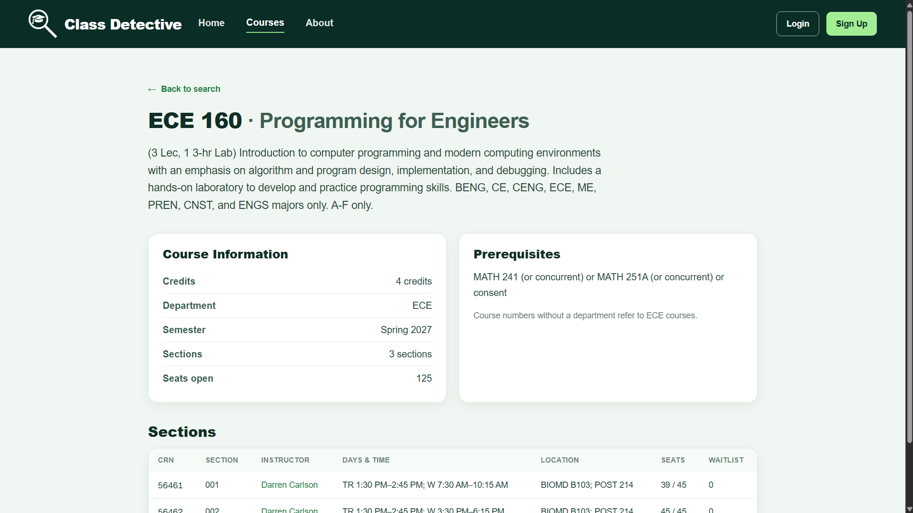
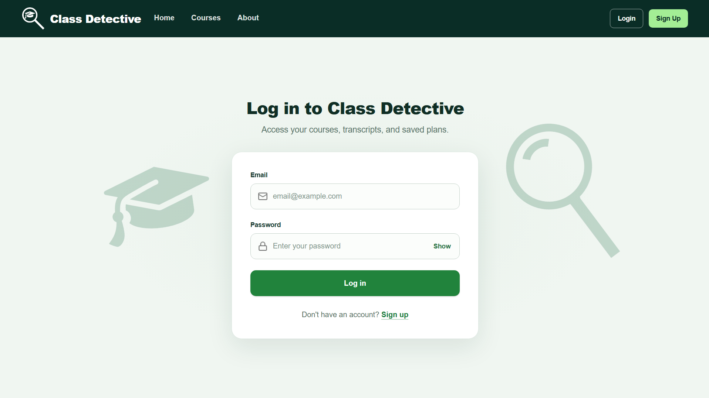
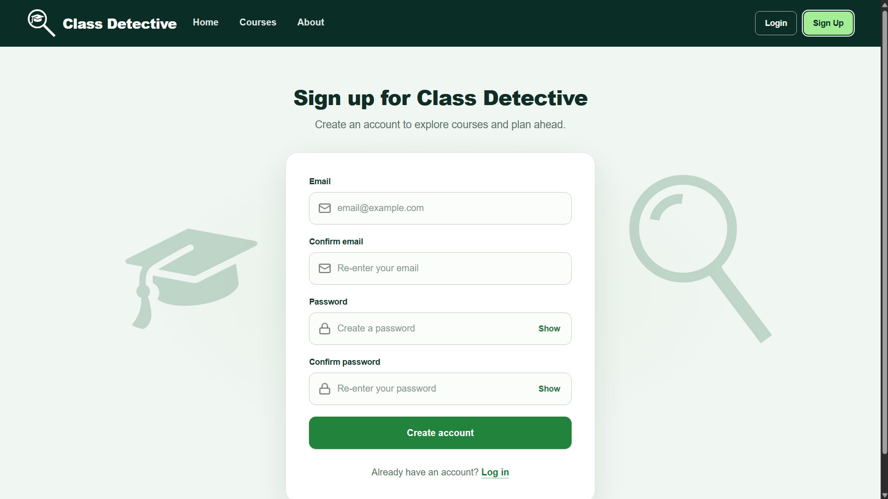

# Class Detective

**Find the classes you're eligible to take—and plan your next semester with friends.**

## About Class Detective

Class Detective is a web application designed to help students discover courses, understand prerequisites, and plan their academic paths using their course histories.

Rather than manually sifting through Star GPS and tediously checking individual prerequisites, students can upload their transcripts to find classes they're eligible for. Class Detective also aims to make planning more collaborative: students will be able to add friends and see which classes their friends are planning to take.

## Core Features

### Student Accounts

Create an account and sign in to save academic information and course plans.

### Transcript Uploads and Course Entry

Upload an academic transcript or manually enter completed courses to build an academic history.

### Course Search and Information

Browse available courses, search for classes, and view course details such as descriptions, credits, and prerequisites.

### Prerequisite and Eligibility Guidance

Compare course requirements with completed coursework to identify classes a student may be eligible to take. Courses requiring instructor or department consent may need additional review.

### Academic Planning

Explore courses for future semesters and keep track of classes you plan to take.

### Friends and Shared Plans

Add friends and view the courses they plan to take, making it easier to coordinate schedules and plan classes together.

## Milestone 1: Current Progress

Milestone 1 established the initial application and development workflow. Our team has worked on:

- A deployed Next.js application with a landing page and shared navigation.
- Front-end login and registration pages, including form fields and basic validation. Full account authentication is still being integrated.
- A course-browsing interface and course-information displays.
- Initial integration with University of Hawaiʻi course data.
- A transcript JSON structure and tools for processing transcript data.
- Initial prerequisite-checking and eligibility work.

## Deployment

The current version of Class Detective is deployed on Vercel:

[Visit the Class Detective application](https://class-detective.vercel.app/)

## Screenshots

### Milestone 1 Application Screenshots

These screenshots document the application developed during Milestone 1. They show the current interface and foundational features; some workflows are still being integrated.

#### Landing Page

#### Course Browsing

#### Course Information

#### Login Page

#### Registration Page

## Project Management

Our development is organized through GitHub issues and milestone project boards.

- [Class Detective GitHub Organization](https://github.com/class-detective)
- [Application Repository](https://github.com/class-detective/class-detective)
- [Project Website Repository](https://github.com/class-detective/class-detective.github.io)
- [Milestone 1 Project Board](https://github.com/orgs/class-detective/projects/1)
- [Milestone 2 Project Board](https://github.com/orgs/class-detective/projects/3)
- [Team Contract](https://docs.google.com/document/d/1NyuTZiJUWoBOSJZe7WiHT4qbRAU3zjKPXhlXxllPdr8/edit?usp=sharing)

## Beyond the Basic Features

After the core features are working, additional features we may explore include:

- Professor ratings and additional professor-based filtering.
- More advanced sorting and filters for semester and campus.
- Expanded transcript history tools.
- Account profile customization.

## Development Team

- Jenna Harrison
- Evan Morgan
- John Leevi Domingo
- Charles Thompson
