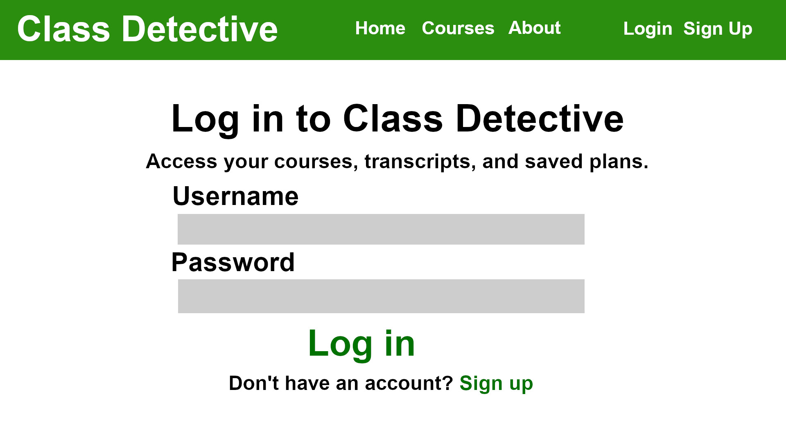
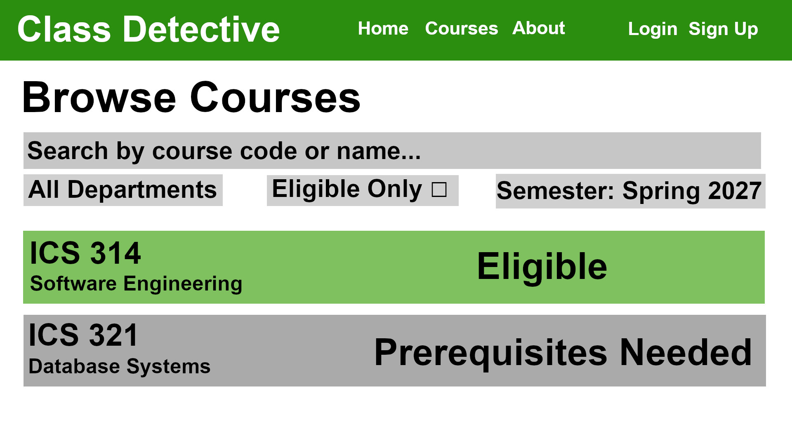
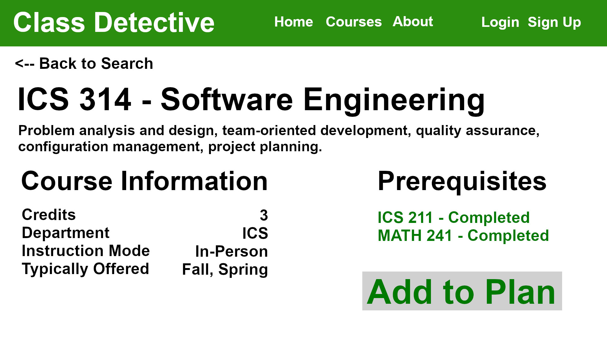

# Class Detective

**Find the classes you're eligible to take.**

## About Class Detective

Class Detective is a web application designed to help students discover courses they are eligible to take based on their academic history.

Rather than manually searching through STAR GPS and tediously checking individual prerequisites, students can upload their transcripts or enter their completed courses to find classes they're eligible for.

## Planned Features

### Student Accounts
Students will be able to register for an account and log in to access the web application.

### Transcript Uploads
Students will be able to upload their academic transcripts.

### Manual Course Entry
Students will also have the option to manually enter completed courses instead of uploading a transcript.

### Course Search
Students will be able to browse courses and filter results based on eligibility and completed prerequisites.

### Course Information
Students will be able to select courses to view additional information about them.

## Planned Pages

Our application will include the following pages:

- **Registration:** Create a student account.
- **Login:** Sign in to an existing account.
- **Landing:** Welcome page with navigation to application features.
- **Course Search:** Search for available courses.
- **Course Display:** Browse eligible courses and view their information.

## Beyond the Basic Features

Once our core functionality is complete, we hope to explore additional features:

- Sorting courses by professor
- Professor ratings
- Filtering by campus and semester
- Viewing past transcripts
- Uploading new transcripts
- Account management and profile customization

## Development Team

- Jenna Harrison
- Evan Morgan
- John Leevi Domingo
- Charles Thompson
